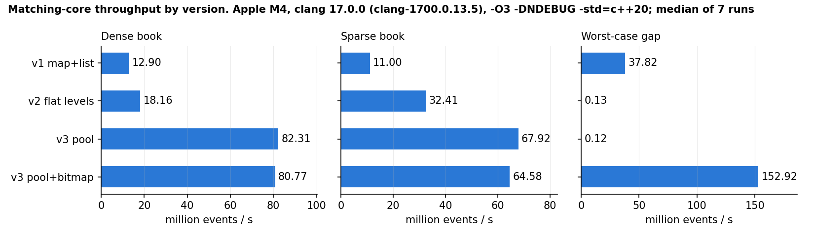

# Benchmarks

Every number in this repository comes from `lob_bench`. Nothing is estimated and nothing is compared with
any real exchange or firm system.

## Reproduce

```bash
cmake --preset release && cmake --build --preset release
./build/release/bench/lob_bench --json results/my-machine.json     # about 2.5 minutes
./build/release/bench/lob_bench --quick                            # about 15 seconds, noisier
```

The tool prints the tables below as markdown and writes the same data, with the hardware, OS, compiler and
flags it detected, as JSON. `--pin` pins threads to cores on Linux. `--seed`, `--events` and `--runs` change
the workload size and repetition.

## Results: Apple Silicon (local machine)

| | |
|---|---|
| CPU | Apple M4, 10 logical cores (4 performance, 6 efficiency) |
| OS | macOS 15.5 (Darwin 24.5.0), arm64 |
| Compiler | Apple clang 17.0.0 (clang-1700.0.13.5) |
| Flags | `-O3 -DNDEBUG -std=c++20` (CMake Release; no `-march`/`-mcpu` tuning, no LTO, no PGO) |
| Clock | `std::chrono::steady_clock`, 41 ns resolution, about 20 to 27 ns per call |
| Run | 5,000,000 events per replay, 1 warmup + 7 timed runs, seed 1, 2026-11-13 |

Raw output: [`results/bench-apple-m4.md`](results/bench-apple-m4.md),
[`results/bench-apple-m4.json`](results/bench-apple-m4.json).



### Matching core, dense book

Single thread, events already decoded, in memory. 61.6% new orders, 31.7% cancels, 6.7% modifies;
1.33 million trades; about 15,000 resting orders on about 250 price levels.

| Version | M events/s (median) | min..max | CV | vs v1 | p50 ns | p99 ns | p99.9 ns | p99.99 ns | max ns |
|---|---:|---:|---:|---:|---:|---:|---:|---:|---:|
| v1 `std::map` + `std::list` | 12.90 | 12.81..13.01 | 0.6% | 1.0x | 42 | 251 | 375 | 3,135 | 60,750 |
| v2 flat price levels | 18.16 | 17.88..18.19 | 0.6% | 1.4x | 42 | 251 | 335 | 959 | 56,209 |
| v3 pool, no allocation | 82.31 | 81.66..83.22 | 0.7% | 6.4x | 0 | 42 | 85 | 211 | 45,333 |
| v3 + bitmap (default) | 80.77 | 80.01..81.17 | 0.5% | 6.3x | 0 | 42 | 85 | 211 | 37,584 |

### Matching core, sparse book

About 1,700 resting orders spread over about 1,300 price levels, so most orders are alone at their price.

| Version | M events/s (median) | min..max | CV | vs v1 | p50 ns | p99 ns | p99.9 ns | p99.99 ns | max ns |
|---|---:|---:|---:|---:|---:|---:|---:|---:|---:|
| v1 | 11.00 | 10.97..11.07 | 0.4% | 1.0x | 83 | 211 | 295 | 2,047 | 54,500 |
| v2 | 32.41 | 31.43..32.83 | 1.4% | 2.9x | 41 | 85 | 167 | 251 | 49,083 |
| v3 | 67.92 | 67.16..68.67 | 0.7% | 6.2x | 0 | 42 | 125 | 211 | 42,666 |
| v3 + bitmap | 64.58 | 63.86..65.31 | 0.7% | 5.9x | 0 | 42 | 85 | 211 | 26,709 |

### Matching core, worst-case gap

One bid rests at price 100. A second bid is added at 60,000 and cancelled, 125,000 times. Every cancel
empties the best level, and the next non-empty level is 59,900 ticks away.

| Version | M events/s (median) | p50 ns | p99 ns | p99.9 ns | max ns |
|---|---:|---:|---:|---:|---:|
| v1 | 37.82 | 41 | 42 | 83 | 11,583 |
| v2 | 0.13 | 13,567 | 18,943 | 27,647 | 87,958 |
| v3 | 0.12 | 13,567 | 20,991 | 33,791 | 467,959 |
| v3 + bitmap | 152.92 | 0 | 42 | 125 | 17,750 |

### Wire to wire: serial versus the v4 pipeline

Decode the binary message, match it, encode every output event. Dense workload.

| Configuration | M msgs/s (median) | min..max | CV |
|---|---:|---:|---:|
| 1 thread | 54.42 | 54.01..55.06 | 0.7% |
| v4: 3 threads, 2 SPSC queues | 22.57 | 14.58..22.91 | 14.2% |

### v4 pipeline latency at fixed arrival rates

Open loop, measured from each message's scheduled send time to the moment its last output event is
published. Three runs merged per rate; the first 10% of each run is discarded.

| Arrival rate, msgs/s | Samples | p50 ns | p90 ns | p99 ns | p99.9 ns | p99.99 ns | max ns |
|---:|---:|---:|---:|---:|---:|---:|---:|
| 100,000 | 1.08M | 167 | 463 | 1,375 | 6,527 | 720,895 | 967,208 |
| 500,000 | 5.4M | 167 | 167 | 335 | 3,135 | 9,983 | 59,833 |
| 1,000,000 | 10.8M | 167 | 167 | 251 | 3,519 | 13,055 | 48,542 |
| 2,000,000 | 13.5M | 167 | 167 | 251 | 3,199 | 15,871 | 152,167 |
| 4,000,000 | 13.5M | 167 | 167 | 211 | 2,687 | 7,935 | 32,250 |

## Results: Linux (GitHub Actions)

The CI `benchmark` job runs the same tool on a GitHub-hosted `ubuntu-24.04` runner with GCC 14 and uploads
`bench-ci.json` and `bench-ci.md` as a build artifact on every push. The Pages build runs it again and the
live demo shows that run under "this site's build machine". Hosted runners are shared virtual machines, so
treat those numbers as indicative and noisy; they are recorded, not used as a pass/fail gate, and are
deliberately kept separate from the Apple Silicon table above.

## What the numbers say

1. **The allocator, not the tree, was the main cost.** Replacing the `std::map` with a flat array bought
   1.4x on the dense book. Removing per-order heap allocation bought a further 4.5x.
2. **The flat array matters more when the book is sparse** (2.9x), because a sparse book creates and
   destroys price levels constantly, and each of those is a tree insert or erase plus an allocation.
3. **The bitmap costs 2% (dense) to 5% (sparse) of throughput and removes a 1,000x cliff.** Without it
   the flat array has an input that takes about 14 microseconds per event. It is on by default.
4. **`std::map` wins the worst-case gap against a plain flat array.** A tree does not care how far apart
   two prices are. This is the honest argument for the tree, and the reason the bitmap exists.
5. **The pipeline is 2.4x slower than one thread at peak throughput.** See DESIGN.md section 2 (v4).
   It also has the noisiest result in the file (CV 14%): three busy-spinning threads on a laptop are at
   the mercy of the scheduler.
6. **Pipeline latency is flat across rates at the median** (167 ns, which is 4 clock ticks) and the tail
   is set by the operating system, not by the engine: the 100,000 msgs/s row has the worst p99.99 because
   at low rates the cores idle between messages and are more likely to be descheduled or clocked down.

## Profiling

Method: `lob_bench --profile v1|v2|v3` replays the dense workload in a loop while the macOS `sample` tool
takes a stack sample every millisecond for 5 seconds (about 3,900 samples per run). The table gives the
share of samples whose innermost frame is in each library.

```bash
./build/release/bench/lob_bench --profile v1 --events 2000000 --seconds 9 &
sample $! 5 -file profile-v1.txt
```

| Version | `malloc`/`free` (libsystem_malloc) | `memset`/`bzero` | Engine code |
|---|---:|---:|---:|
| v1 | 41.5% | 3.6% | 54.9% |
| v2 | 56.6% | 4.3% | 39.1% |
| v3 | 0.0% | 0.0% | 99.6% |

What the profile showed and what was changed:

- **v1.** Two fifths of the time is in the allocator. The largest engine frames are
  `ListBook::remove` (hash lookup, list unlink, tree lookup) and `MapLevels::drop_if_empty` (tree find and
  erase). Change: index levels directly by price (v2).
- **v2.** The tree frames are gone, total time fell, and the allocator's *share* rose to 57%: every order
  still allocates a list node and a hash-map node and frees both. Change: preallocated pool, intrusive
  links, open-addressing id table (v3).
- **v3.** No allocator frames during replay. All samples are in the matching loop itself or its inlined
  callees. The remaining 0.4% is the kernel returning memory when a book is destroyed between replays.

`sample` is a wall-clock stack sampler, not a hardware-counter profiler, so it attributes time but cannot
count cache misses or branch mispredictions. On Linux the equivalent is
`perf record -g ./build/release/bench/lob_bench --profile v3` and `perf stat -e cache-misses,branch-misses`.

## Methodology

- **Workload.** Generated once per run from a fixed seed by `FlowGenerator`, using the project's own PRNG so
  the stream is identical on every platform. It is a synthetic stress workload, not market data. The
  generator runs a shadow book so cancels and modifies target orders that are really resting.
- **Same input for every version.** Each book replays the identical in-memory event vector, and the harness
  aborts if the versions' output checksums differ.
- **Throughput.** One untimed warmup replay, then 7 timed replays, each on a freshly constructed book
  (construction and page-touching are outside the timed region). Throughput is events divided by wall time
  for the whole replay, with no clock calls inside the loop. Reported as the median, with min, max and
  coefficient of variation.
- **Latency.** Separate replays (3 per book, merged) with a clock read before and after every event,
  recorded in a log-linear histogram with at most 3% relative error. The first 10% of each replay is
  skipped while the book fills.
- **Pipeline latency.** Open loop at a fixed arrival rate. Message `i` is released at
  `start + i * period` and its latency is measured from that scheduled time, so a stall delays later
  messages' *measured* latency instead of silently pausing the load (no coordinated omission). The clock
  starts only once all three threads are running. Threads busy-spin; they never sleep or yield in the
  benchmark.
- **Threads and cores.** macOS has no thread-affinity API on Apple Silicon; threads request the
  user-interactive QoS class, which keeps them on performance cores. Nothing else was done to quiet the
  machine: no core isolation, other applications were running.

## Caveats, stated plainly

- **Clock resolution.** On Apple Silicon the clock ticks every 41.67 ns and a matching operation takes
  about 12 ns. Per-event latencies are therefore quantised to multiples of about 42 ns, and a p50 of 0
  means "less than one tick". Mean service time is better read from throughput: 1 / 80.77M per second is
  12.4 ns per event. The percentiles are still meaningful for the tail.
- **Clock overhead.** Each timed event includes two clock reads of 20 to 27 ns each, which is why the
  latency runs are not used for throughput.
- **Maxima are scheduler noise.** Maximum latencies of 20 to 60 microseconds appear for every version,
  including v3, which does no allocation and no system calls. They are preemptions and interrupts.
- **In-memory only.** No network, no disk, no kernel in the hot path. These numbers describe the data
  structure and the queue, not a deployed system.
- **One machine, one compiler for the headline table.** Results on other hardware will differ; the JSON
  records what produced each data set.
