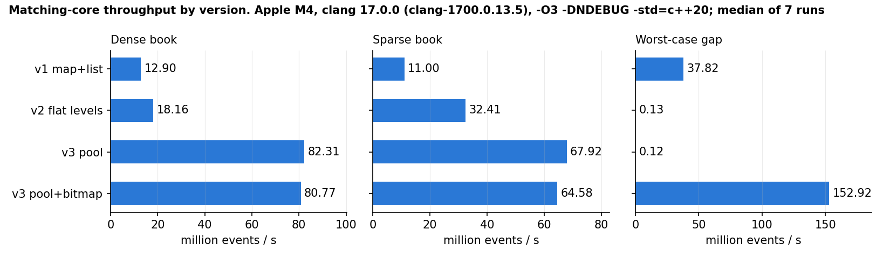
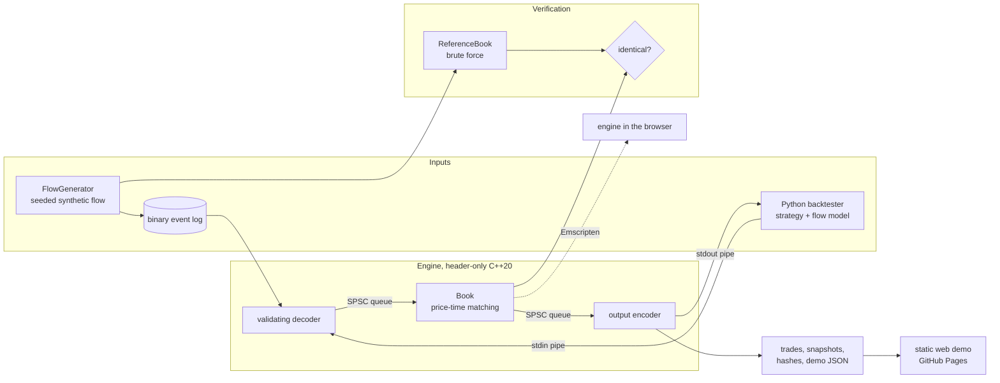
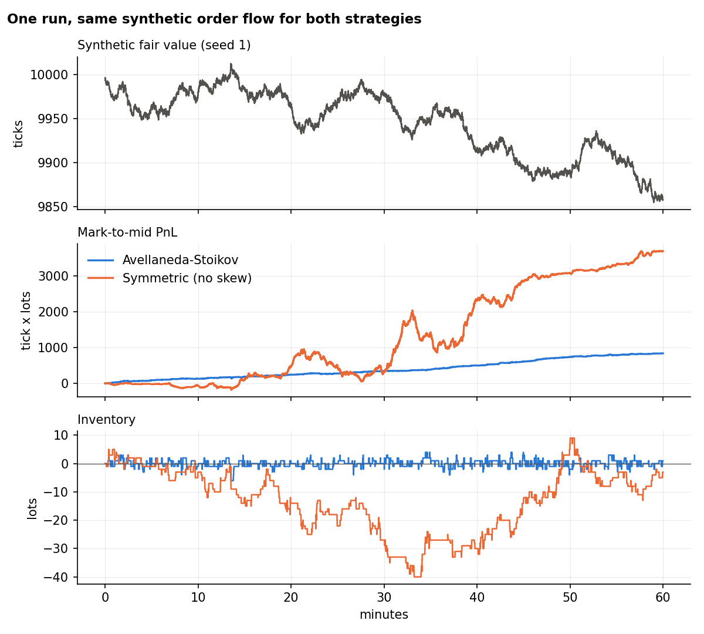

# lob-engine

A C++20 limit order book and matching engine, built in four measured steps from a textbook
`std::map` design to an allocation-free book, with a lock-free pipeline, a binary replay format, a Python
market-making backtester that drives the real engine, and a static web demo. Every fast version is checked
event by event against a brute-force reference over millions of random events, and every number below was
measured with one documented command.

**Live demo:** https://pottakushal.github.io/lob-engine/ (order book replay, benchmark tables, strategy
study, and the real engine compiled to WebAssembly so you can submit orders in the browser)



## Results

Apple M4, macOS 15.5, Apple clang 17, `-O3 -DNDEBUG -std=c++20`, single thread, 5 million synthetic events
per replay, median of 7 runs. Full tables, method and caveats: [BENCHMARKS.md](BENCHMARKS.md).

| Version | What changed | M events/s | vs v1 | p99 ns | p99.9 ns |
|---|---|---:|---:|---:|---:|
| v1 | `std::map` levels, `std::list` orders, `std::unordered_map` index | 12.90 | 1.0x | 251 | 375 |
| v2 | flat array of price levels | 18.16 | 1.4x | 251 | 335 |
| v3 | order pool, intrusive queues, open-addressing id table: no heap allocation | 82.31 | 6.4x | 42 | 85 |
| v3 + bitmap (default) | two-level bitmap of non-empty levels | 80.77 | 6.3x | 42 | 85 |
| v4 | v3 + bitmap behind a 3-thread SPSC pipeline, wire to wire | 22.57 | | 251 at 1M msgs/s | 3,519 |

Three results worth knowing before reading further:

- **The allocator was the bottleneck, not the tree.** Profiling showed 42% of v1 and 57% of v2 in
  `malloc`/`free`. Removing allocation was worth 4.5x; replacing the tree only 1.4x.
- **The bitmap makes the average case 2% slower and is still the default.** A flat price array has a
  worst case (best level empties, next level far away) that ran at 0.12M events/s. With the bitmap the same
  input runs at 153M events/s.
- **The multi-threaded pipeline is slower than one thread** (22.6M versus 54.4M messages per second, wire
  to wire). At about 18 ns of work per message, crossing two queues costs more than it saves.
  [DESIGN.md](DESIGN.md) explains why, and when the pipeline is still the right structure.

The per-event clock on Apple Silicon ticks every 41 ns, so latency percentiles are quantised to that; see
the caveats in BENCHMARKS.md. Linux numbers are produced by CI and kept separate.

## Quickstart

```bash
cmake --workflow --preset release      # configure, build, run all 110 tests
```

```bash
./build/release/bench/lob_bench        # benchmarks (about 2.5 minutes; --quick for 15 seconds)
```

```bash
python3 -m venv .venv && .venv/bin/pip install -r python/requirements.txt
.venv/bin/python python/run_backtest.py --seeds 50 --horizon 3600 --out results --img docs/img
```

```bash
scripts/build_site.sh --quick && python3 -m http.server -d _site 8000   # the demo at localhost:8000
```

Other presets: `debug`, `asan` (AddressSanitizer + UBSan), `tsan` (ThreadSanitizer), `fuzz` (libFuzzer,
LLVM clang only). Requirements: CMake 3.25+, a C++20 compiler (tested with Apple clang 17 and GCC 16),
Python 3 for the research layer (tested with 3.13). GoogleTest is fetched at a pinned version and checksum.

## Architecture



The book is a deterministic function of its input sequence and is owned by one thread. Everything else
(decoding, encoding, queues, the Python process, the browser) sits around it.

## What is in the box

| Path | Contents |
|---|---|
| `include/lob/book.hpp` | v3 book: flat levels, order pool, intrusive FIFOs, id table, bitmap |
| `include/lob/book_list.hpp` | v1 and v2 books, sharing everything except the level container |
| `include/lob/reference_book.hpp` | brute-force reference used by the tests |
| `include/lob/spsc_queue.hpp` | lock-free SPSC ring buffer, with the memory-ordering argument |
| `include/lob/pipeline.hpp` | three-thread pipeline and open-loop latency measurement |
| `include/lob/protocol.hpp` | binary wire format and validating decoder |
| `include/lob/histogram.hpp` | log-linear latency histogram |
| `tools/lob_cli.cpp` | `gen`, `run`, `verify`, `stream`, `demo` |
| `bench/bench_main.cpp` | benchmark harness |
| `tests/`, `fuzz/` | rule tests, differential tests, queue and pipeline tests, fuzz target |
| `python/` | synthetic flow model, Avellaneda-Stoikov quoter, closed-loop backtester, plots |
| `web/` | static visualizer and the WebAssembly bindings |

## Order types and rules

Limit, market, IOC, FOK and post-only orders; cancel; modify with documented priority rules (a size
reduction keeps its place in the queue, anything else goes to the back); self-trade prevention by
cancelling the incoming order. Prices are integer ticks. The full specification is in
[DESIGN.md](DESIGN.md#1-matching-rules-the-specification).

## How correctness is checked

- **Differential testing.** A deliberately simple reference book (one unsorted vector, scanned for every
  decision) and the four fast books process the same randomized stream. After every event their output
  must be identical; periodically their full resting state must be identical. The default run checks
  8 million events and fails if any cancel or reject reason was never exercised.
- **Mutation check.** Five seeded bugs in the fast book were all caught by that suite.
- **Fuzzing.** A libFuzzer target feeds arbitrary bytes to the decoder and applies whatever decodes to both
  the fast book and the reference.
- **Sanitizers.** The suite passes under AddressSanitizer, UndefinedBehaviorSanitizer and ThreadSanitizer.
- **Replay.** A log replayed on any version, compiler or platform yields the same output hash and state
  hash; a golden hash is pinned in the tests and matches under both libc++ and libstdc++.

## Strategy study (synthetic data)

An inventory-aware Avellaneda-Stoikov market maker and a symmetric baseline, run through the engine against
synthetic flow that includes informed traders, over 50 seeds. The inventory skew cuts the standard deviation
of inventory from 11.3 to 1.1 lots and the standard deviation of final PnL by a factor of twenty, at a
similar mean. The model, the statistics and a frank list of what the simulation leaves out are in
[docs/STRATEGY.md](docs/STRATEGY.md).



## Documents

- [DESIGN.md](DESIGN.md): rules, data structures, alternatives rejected, limitations, next steps
- [BENCHMARKS.md](BENCHMARKS.md): results, profiling, methodology, caveats
- [docs/STRATEGY.md](docs/STRATEGY.md): flow model, quoting rule, metrics, limits
- [INTERVIEW_NOTES.md](INTERVIEW_NOTES.md): how to explain and defend the project
- [PLAN.md](PLAN.md): the original plan and cut order

## Scope and honesty notes

All order flow is synthetic. The engine handles one instrument in memory; there is no network layer,
persistence, or exchange connectivity. Numbers are from a laptop without core isolation and are not
compared with any production system. Known limitations are listed in DESIGN.md.

## License

MIT. See [LICENSE](LICENSE).
