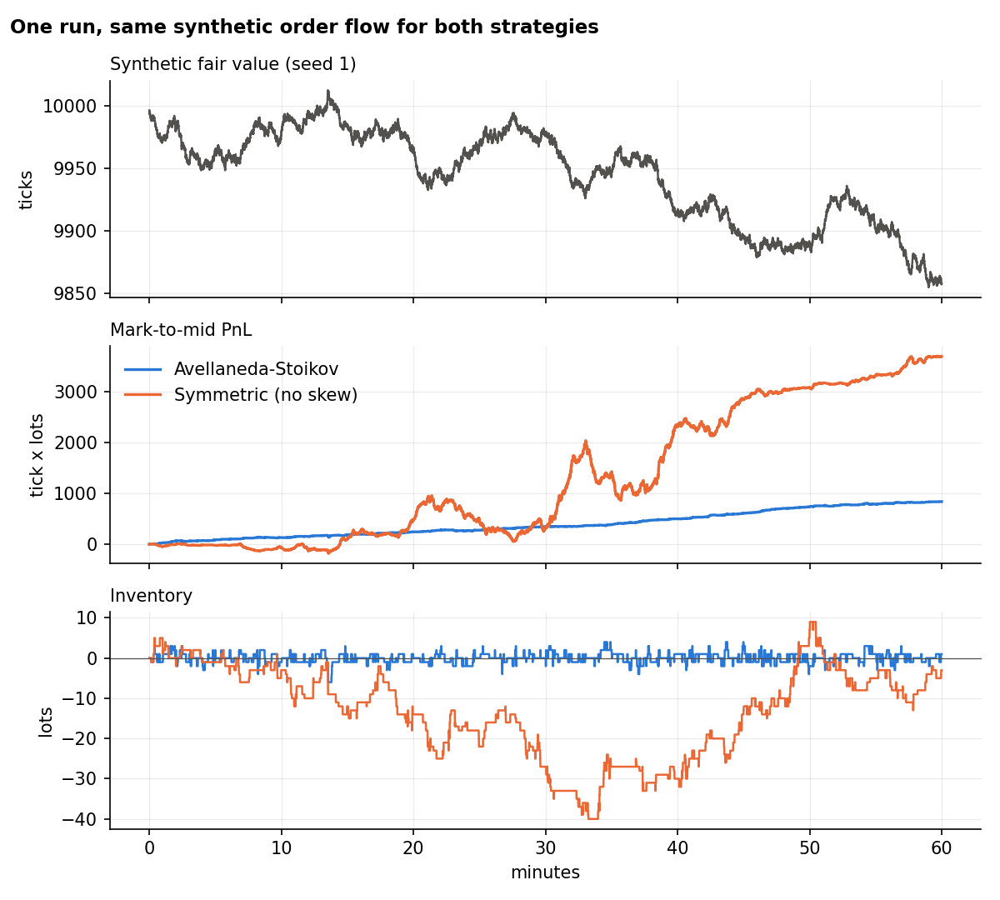
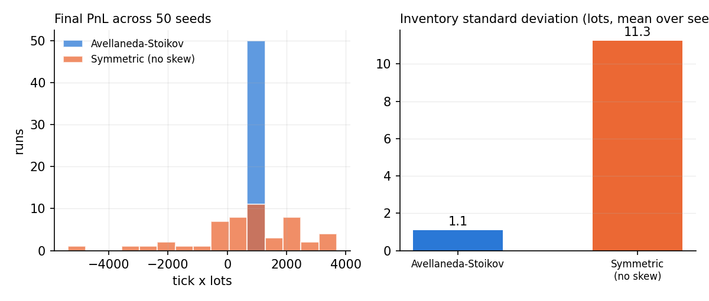

# Market-making study: method, statistics and limits

**Everything here runs on synthetic order flow. It is a model study that exercises the engine and the
research tooling. It is not evidence that any strategy makes money in a real market.**

Reproduce with one command (about one minute):

```bash
python python/run_backtest.py --cli build/release/tools/lob_cli --seeds 50 --horizon 3600 --out results --img docs/img
```

## How the backtest works

The Python backtester does not simulate fills. It starts the C++ engine as a child process
(`lob_cli stream`) and sends it binary order messages over a pipe. Every quarter second of simulated time:

1. the strategy cancels and re-posts its quotes (post-only limit orders), using only what it knew at the
   end of the previous step;
2. the background order flow for the step is sent, in random order;
3. the engine's output events come back, and fills, positions and the tracked book are updated from them.

The strategy's quotes rest in the same book as the background orders, so a fill happens only when the real
matching engine says it does, at the quote's true queue position. The strategy's reference price is the mid
of the book *excluding its own orders*; otherwise it would be quoting around itself.

## The synthetic flow model

Defined in [`python/lobpy/flow.py`](../python/lobpy/flow.py). Per step of length `dt`:

| Component | Model | Default |
|---|---|---|
| Fair value `F` | Gaussian random walk, `F += sigma * sqrt(dt) * Z` | `sigma` = 1.5 ticks per sqrt(second) |
| Passive limit orders | Poisson arrivals per side, priced at `round(F) -/+ d`, `d = 2 + Geometric(0.25) - 1` | 12 per second per side |
| Cancellations | each resting order has a constant hazard, so its lifetime is exponential | 0.15 per second |
| Uninformed market orders | Poisson arrivals per side | 1.2 per second per side |
| Informed market orders | Poisson arrivals, always in the direction of `F(t + 5 s) - F(t)` | 1 per second |
| Order size | uniform on 1..5 lots | |

Two properties follow directly. With arrival rate `lambda` per side and cancel hazard `delta`, the number of
resting orders is an M/M/infinity queue with stationary mean `2 * lambda / delta` (160 here, less whatever
trades). And because passive orders are priced off the current fair value, a move in `F` makes new orders
cross stale ones, which is the mechanism that drags the book along with `F`.

The informed traders are what makes the problem interesting. They know where the price is going, so the
quotes they hit are, on average, about to be wrong. That loss is **adverse selection**.

An optional Hawkes variant makes uninformed market orders self-exciting (each arrival raises the arrival
rate, which then decays exponentially), with branching ratio `hawkes_alpha < 1`. It is off by default and
was not used for the reported numbers.

## The quoting rule

Avellaneda and Stoikov (2008) consider a dealer who maximises expected exponential utility of terminal
wealth, `-exp(-gamma * W)`, when the mid price is Brownian with variance `sigma^2` per second and a quote at
distance `delta` from the mid is hit with Poisson intensity `A * exp(-k * delta)`.

**Reservation price.** Holding inventory `q` over a horizon `tau` exposes the dealer to a wealth variance of
`q^2 * sigma^2 * tau`. For exponential utility and Gaussian risk the certainty-equivalent penalty is
`(gamma / 2) * q^2 * sigma^2 * tau`. The price at which the dealer is indifferent to trading one more unit
is the derivative of that penalty with respect to `q`, taken off the mid:

```
r = s - q * gamma * sigma^2 * tau
```

A long dealer values the asset below the mid and shades both quotes down, which makes a sale more likely and
a purchase less likely. Inventory is therefore mean-reverting by construction.

**Spread.** The optimal total spread is

```
spread = gamma * sigma^2 * tau + (2 / gamma) * ln(1 + gamma / k)
```

The first term is compensation for price risk. The second is the spread that maximises expected profit per
unit time against the exponential fill curve: quote wider and each fill earns more, but fills arrive
exponentially less often. As `gamma` goes to zero the second term tends to `2 / k`, the risk-neutral
optimum.

**Implementation choices.** `tau` is held constant (the stationary simplification), so quotes do not
collapse towards the end of a run. `sigma^2` is not given to the strategy; it is estimated online as an
exponentially weighted average of squared reference-price changes. Quotes are rounded outward to whole
ticks. There is a hard inventory limit of 40 lots, after which the strategy stops quoting on the side that
would increase the position.

**Baseline.** The same spread with the inventory term switched off (`r = s`). Comparing the two isolates
what the reservation price contributes.

## Metrics

- **PnL** is marked to the reference mid: cash plus inventory times mid, in tick-lots.
- **Fill rate** is the fraction of posted quotes that received at least one fill.
- **Spread captured** is the signed distance between the fill price and the reference mid when the quote
  was placed, per lot.
- **Markout** is the same distance measured against the mid 5 seconds after the fill.
- **Adverse selection** is spread captured minus markout: how much of the captured spread the market took
  back within 5 seconds.
- **Run Sharpe** is the mean of one-minute PnL increments divided by their standard deviation, times the
  square root of the number of minutes. It is a t-statistic for "mean PnL per minute is zero" over one run,
  not an annualised Sharpe ratio.
- **Mean over standard deviation across seeds** treats each seed as one independent draw of final PnL.

## Results

50 seeds, 60 simulated minutes each, about 20 million engine output events in total. Mean ± standard
deviation across seeds.

| Metric | Avellaneda-Stoikov | Symmetric baseline |
|---|---:|---:|
| Final PnL, tick-lots | 917 ± 88 | 757 ± 1,790 |
| Runs with positive PnL | 100% | 74% |
| Mean PnL / std of PnL across seeds | 10.4 | 0.42 |
| Inventory standard deviation, lots | 1.10 ± 0.06 | 11.25 ± 2.65 |
| Largest absolute inventory, lots | 4.6 ± 0.7 | 35.0 ± 7.0 |
| Quotes that received a fill | 8.9% | 8.0% |
| Spread captured at fill, ticks per lot | 1.61 ± 0.01 | 1.80 ± 0.03 |
| Value 5 s after fill, ticks per lot | 1.18 ± 0.08 | 1.08 ± 0.12 |
| Adverse selection, ticks per lot | 0.43 ± 0.07 | 0.73 ± 0.13 |
| Run Sharpe (t-statistic of 1-minute PnL) | 8.7 ± 1.4 | 0.63 ± 1.09 |




**Reading the result.** Both strategies earn a similar amount on average, because both collect roughly the
same spread from uninformed flow. The difference is risk. Without the skew, inventory wanders like a random
walk until the hard limit stops it, and final PnL is dominated by whatever the price did while the position
was open: the standard deviation of PnL is twenty times larger. The skew gives up about 0.2 ticks of
captured spread per lot (it deliberately quotes a worse price on the side that reduces inventory) and in
exchange cuts inventory dispersion by a factor of ten. It also loses less to adverse selection, because a
position built by informed flow is worked off sooner.

In the example plot the baseline finishes ahead. That run's price fell while the baseline happened to be
short. It is one draw from a distribution whose spread is twenty times wider, which is the point.

## Limits of the model

A Sharpe-like statistic near 9 would be absurd for a real strategy, and it is a property of the simulator,
not of the strategy:

- **No competition.** The strategy is the only liquidity provider quoting inside the background book. Real
  spreads are competed down to roughly the cost of adverse selection plus fees.
- **Exogenous flow.** Background orders do not react to the strategy's quotes or to its inventory. There is
  no market impact and nobody learns from the strategy's behaviour.
- **No fees, rebates, tick-size constraints from a real venue, or latency.** The strategy's cancels and
  quotes arrive instantly and always before the step's background flow.
- **Informed flow is stylised.** Informed traders know the future fair value exactly and arrive at a
  constant rate; real toxicity is bursty and correlated with volatility.
- **Gaussian fair value, constant volatility, no jumps.** The Avellaneda-Stoikov derivation assumes the
  same thing, so the model flatters the strategy.
- **Parameters were chosen, not fitted.** `gamma`, `k` and `tau` were set to give quotes a tick or two
  inside the background book; nothing was calibrated to data, and there is no out-of-sample test because
  there is no real sample.
- **Fifty seeds** give a standard error on the mean PnL of about 12 tick-lots for the skewed strategy and
  about 250 for the baseline, so the difference in *mean* PnL between the two is not statistically
  significant. The difference in *dispersion* is.

What the study does show: the engine can host a closed-loop strategy simulation with real queue priority,
and the tooling can measure inventory risk and adverse selection well enough to see the textbook effect of
the reservation price.
